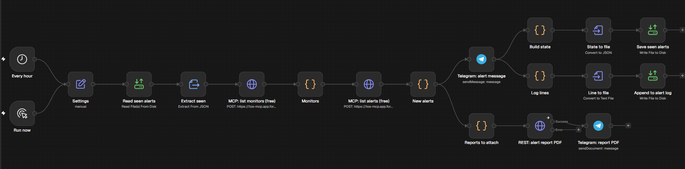
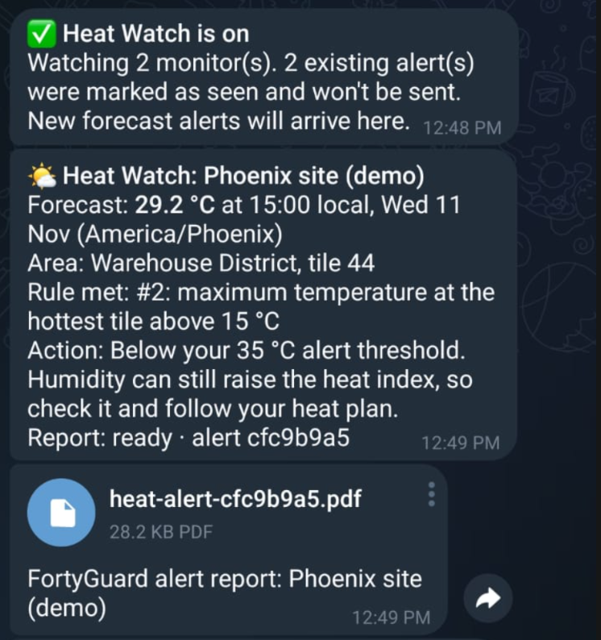
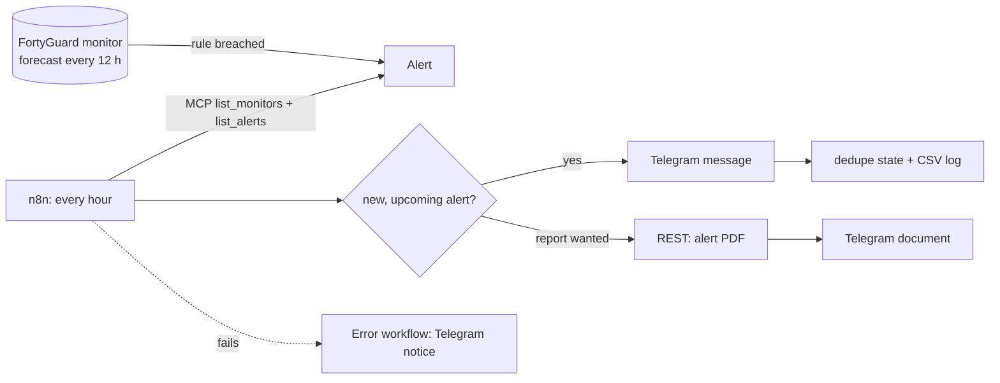
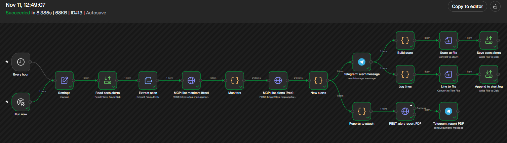

# FortyGuard Site Heat Watch

[](https://github.com/ziadelboshy/fortyguard-heat-watch/actions/workflows/ci.yml)
[](LICENSE)
[](https://n8n.io)
[](planner/)
[](n8n/)

**Heat alerts for outdoor crews, delivered where they already are.** An n8n workflow watches your [FortyGuard](https://www.fortyguard.com/product-temperature-mcp) heat monitors and turns each new forecast alert into a Telegram message with a clear next step, plus the PDF report when it matters.



## Why

FortyGuard monitors forecast heat for a site every 12 hours and raise an alert when a rule is breached, sending it by email, SMS or WhatsApp. Crew leads often live in a team chat instead. This project forwards each new alert there with a clear next step, using only FortyGuard's free read operations for the hourly check.

## Features

- **Hourly, free check.** Uses the MCP's free `list_monitors` and `list_alerts` operations, called over plain HTTP. No custom n8n node.
- **Actionable messages.** Site, forecast temperature and local time, the rule that fired, and an action line, e.g. move heavy work earlier and plan water, shade and rest breaks.
- **PDF report attached.** For heat-level alerts by default, only when ready, capped per run. If a download fails, the chat is told and the run carries on.
- **Safe by default.** The first run never replays old alerts, past forecasts are skipped, there are no duplicates in normal operation, and each sent alert is logged to CSV.
- **Loud failures.** A second workflow messages you if a run breaks, including when no monitor matches your settings.
- **Engineered like software.** The Code-node logic lives in tested source files and is built into the workflows. The image is pinned by digest, the container is hardened and localhost-only, and CI covers tests, lint and secret checks.
- **Bonus:** a standard-library heat-safety planner that finds the lowest-heat work window from hourly wet-bulb and humidity data.

## What a message looks like

A real run on 11 Nov 2026. It used a low 15 °C test rule, because November isn't hot, and `attach_report=always` so the PDF branch would run:



```text
🌤️ Heat Watch: Phoenix site (demo)
Forecast: 29.2 °C at 15:00 local, Wed 11 Nov (America/Phoenix)
Area: Warehouse District, tile 44
Rule met: #2: maximum temperature at the hottest tile above 15 °C
Action: Below your 35 °C alert threshold. Humidity can still raise the heat index, so check it and follow your heat plan.
Report: ready · alert cfc9b9a5
```

At or above your threshold, the message is marked 🔥 *heat alert* and suggests a morning window for heavy work. The 35 °C default is an example, not a standard: set it from your own heat plan.

## How it works



The run sequence, data contract, state files and design decisions are in [docs/architecture.md](docs/architecture.md).

## Quick start

**You need:** Docker, bash (on Windows, Git Bash or WSL), Python 3.10+, a FortyGuard API key on a plan with monitoring, and a Telegram bot from [@BotFather](https://t.me/BotFather).

### 1. Get the code and configure

```bash
git clone https://github.com/ziadelboshy/fortyguard-heat-watch.git
cd fortyguard-heat-watch
cp .env.example .env    # then fill in FORTYGUARD_API_KEY, TELEGRAM_BOT_TOKEN, TELEGRAM_CHAT_ID
```

Open your bot in Telegram and press **Start** once, because bots can't open a chat on their own.

### 2. Create a monitor for each site

A monitor watches one finished heatmap. Name it `Heat Watch - <site>`: the workflow only watches monitors with that prefix. With an MCP-connected agent (see [Use it from an AI agent](#use-it-from-an-ai-agent)), ask for example:

> Create a 100 m heatmap of this polygon for 2025-08-18 15:00, then create a monitor on it named "Heat Watch - Houston yard" that alerts when the hottest tile's maximum forecast temperature is above 35 °C, emailing ops@example.com. Show me the credit cost before each paid call.

<details>
<summary>The <code>monitoring</code> call it makes</summary>

```json
{
  "operation": "create_monitor",
  "heatmap_id": "<finished heatmap id>",
  "name": "Heat Watch - Houston yard",
  "boundary_geojson": {"type": "Polygon", "coordinates": [[[-95.375, 29.752], [-95.362, 29.752], [-95.362, 29.764], [-95.375, 29.764], [-95.375, 29.752]]]},
  "rules": [{"temporal_aggregation": "maximum", "spatial_aggregation": "maximum", "operator": "above", "threshold": 35, "unit": "celsius"}],
  "notifications": {"email": ["ops@example.com"]},
  "generate_report": true
}
```
</details>

### 3. Start n8n and load the workflows

```bash
bash scripts/start.sh                          # starts n8n and waits until it is healthy
python3 scripts/setup_n8n.py --env-file .env   # imports 3 credentials and 2 workflows
```

### 4. Test once, then switch it on

```bash
docker exec -e N8N_RUNNERS_BROKER_PORT=5680 heatwatch-n8n n8n execute --id HeatWatchMain001
python3 scripts/setup_n8n.py --env-file .env --publish   # publishes both workflows and restarts n8n
```

The first run sends one "Heat Watch is on" message and records existing alerts without replaying them. After that, each new alert arrives once. Open <http://localhost:5678> to watch runs (n8n asks you to create a local owner account the first time):



## Configuration

**Workflow settings** are in the first node, `Settings`. Edit them in the n8n editor and save. Re-running `setup_n8n.py` resets them to these defaults.

| Setting | Default | Meaning |
|---|---|---|
| `telegram_chat_id` | from `.env` | where alerts go |
| `monitor_name_prefix` | `Heat Watch - ` | watch only enabled monitors whose name starts with this; the rest is the site name |
| `heat_threshold_c` | `35` | at or above this forecast temperature, an alert is a heat alert |
| `attach_report` | `heat_only` | `heat_only`, `always` or `never` |
| `max_reports_per_run` | `2` | upper limit on PDF downloads per run |
| `work_day_start_hour` | `6` | earliest hour the action line suggests |

Invalid values stop the run with a clear error, which the error workflow sends to Telegram.

**Environment** (`.env`): `FORTYGUARD_API_KEY`, `TELEGRAM_BOT_TOKEN` and `TELEGRAM_CHAT_ID` (a numeric ID or a `@channel`) are required. `GENERIC_TIMEZONE` is optional and sets the schedule timezone (default UTC). Alert times always use each monitor's own timezone.

## Cost

The hourly check uses only operations that FortyGuard's MCP marks as free. Published pricing as of Nov 2026:

| Call | Credits | When |
|---|---|---|
| `list_monitors`, `list_alerts` | free | every run |
| `heatmap` | 4,220 | once per site, at setup |
| `create_monitor`, `update_monitor`, `delete_monitor`, `trigger_forecast` | 3,500 each | at setup and teardown |
| Alert report PDF (REST) | 3,500 | only when `attach_report` allows, at most `max_reports_per_run` per run |

Set `attach_report` to `never` to keep the workflow to free reads only. Check FortyGuard's current pricing before relying on these figures.

## Verified

Tested live against FortyGuard with n8n 2.47.4 on 11 Nov 2026:

| Check | Result |
|---|---|
| First run on an account with existing alerts | one "Heat Watch is on" message; 2 alerts recorded, none replayed |
| New upcoming alert | Telegram message with action line, CSV row with the documented columns |
| Re-run | no duplicate message |
| PDF branch | 4-page report delivered as a Telegram document |
| PDF download fails (deliberately broken URL) | "report unavailable" message; the run still succeeds |
| Error path (deliberately broken URL) | failure notice with a link to the failed run |
| Hardened container | healthy with all capabilities dropped and `no-new-privileges` |
| Cost | 0 credits for the hourly checks, measured from the account balance |
| Export round-trip (`export_workflows.py` right after import) | byte-identical to the repository files |

## Project structure

```
.
├── compose.yaml               n8n container: pinned by digest, localhost-only, hardened
├── .env.example               the three secrets (+ optional timezone), names only
├── n8n/
│   ├── workflows/             importable workflows (built: do not edit Code nodes here)
│   ├── src/lib.js             Code-node logic: pure, dependency-free functions
│   ├── src/nodes/             per-node glue
│   └── test/                  node:test unit and workflow-level tests
├── scripts/
│   ├── start.sh               start n8n, create state files, wait until healthy
│   ├── setup_n8n.py           import credentials and workflows (--publish to switch on)
│   ├── build_workflows.py     inline n8n/src into the workflows (--check for CI)
│   ├── export_workflows.py    n8n editor -> repo: export, strip chat ID and metadata, rebuild, check
│   ├── check_workflows.py     structure and secret checks for the workflow files
│   ├── cleanup.sh             remove container, volume and image
│   └── tests/                 tests for the scripts and the secret checks
├── planner/                   heat-safety planner + tests (Python standard library)
├── docs/                      architecture notes and screenshots
└── .github/                   CI and Dependabot
```

## Development

No packages to install: everything runs on the Python and Node standard libraries.

```bash
npm test                                            # 27 tests: library + generated Code nodes
python3 -m unittest discover -s scripts -t scripts  # 7 tests: setup, export and secret checks
python3 -m unittest discover -s planner -t planner  # 17 planner tests
python3 scripts/build_workflows.py                  # after editing n8n/src: rebuild the workflows
python3 scripts/build_workflows.py --check          # fails if the workflows are out of date
python3 scripts/check_workflows.py                  # structure and secret checks
```

Linting uses [ruff](https://docs.astral.sh/ruff/) (config in `pyproject.toml`) and [shellcheck](https://www.shellcheck.net/). CI runs all of the above on pushes to `main` and on pull requests.

- **Change workflow logic:** edit `n8n/src/`, rebuild, run the tests.
- **Change the node graph:** edit it in the n8n editor, then run `python3 scripts/export_workflows.py`. It exports both workflows, puts the chat-ID placeholder back, strips pinned data and metadata, rebuilds the Code nodes from `n8n/src`, and runs the secret checks. Review with `git diff`. Keep the Code nodes' names as listed in `scripts/build_workflows.py`.

## Heat-safety planner

```bash
python3 planner/heat_planner.py planner/sample_env_params.json   # synthetic hot, humid day
```

Give it an hourly `env_params` result from FortyGuard (`wet_bulb_temperature_celsius` and `relative_humidity_percent`) for a site and day. It prints an hourly table, the heat-index peak, the lowest-heat 4-hour work window, and the hours that need extra precautions.

**Method:** it inverts [Stull (2011)](https://doi.org/10.1175/JAMC-D-11-0143.1) to recover approximate air temperature, applies the [NWS heat index](https://www.wpc.ncep.noaa.gov/html/heatindex_equation.shtml) (Rothfusz regression with adjustments), and bands each hour with the [NWS categories](https://www.weather.gov/safety/heat-index).

**Limits:**
- Expect about ±1–2 °C in the recovered air temperature.
- Only −20 to 50 °C and 5–99 % RH are valid; other hours are skipped.
- The heat index assumes shade; full sun adds up to about 8 °C.

`sample_env_params.json` is synthetic (`make_sample.py`), not FortyGuard data.

## Use it from an AI agent

Any MCP client that supports Streamable HTTP with a custom header can drive FortyGuard. Here is [Hermes Agent](https://hermes-agent.nousresearch.com), the client this project was tested with. Put the key in Hermes' `.env` as `FORTYGUARD_API_KEY`, then add to `config.yaml`:

```yaml
mcp_servers:
  fortyguard:
    url: https://tos-mcp.app.fortyguard.com/mcp
    headers:
      Authorization: "Bearer ${FORTYGUARD_API_KEY}"
    timeout: 180
```

Run `hermes mcp test fortyguard`, then start a new chat. If your config pins `platform_toolsets.<platform>` and that list already names an MCP server, add `- mcp-fortyguard` to it, or the tools won't reach the chat.

## Troubleshooting

| Symptom | Fix |
|---|---|
| `Task Broker's port 5679 is already in use` on `n8n execute` | Run it with `-e N8N_RUNNERS_BROKER_PORT=5680`, as shown above. |
| No failure notices arrive | Both workflows must be published: `setup_n8n.py --publish`. |
| The hourly run stopped after re-running setup | Importing unpublishes a workflow. Re-run with `--publish`. |
| Telegram error `chat not found` | Press **Start** in the bot chat, and check `TELEGRAM_CHAT_ID`. |
| `Invalid Settings: ...` | Fix that value in the `Settings` node. |
| `No enabled FortyGuard monitors match the prefix` | Check the monitor names against `monitor_name_prefix` and that the monitors are enabled. |
| `FortyGuard error` or `MCP error` | Check the API key and that your plan includes monitoring. |
| n8n can't write `./data` (Linux) | `sudo chown -R 1000:1000 data` (n8n runs as uid 1000). |

## Clean up

```bash
bash scripts/cleanup.sh               # container + n8n data volume (credentials included) + image
bash scripts/cleanup.sh --keep-image  # container + volume only
bash scripts/cleanup.sh --all         # also delete ./data (log and dedupe state)
```

Delete your FortyGuard monitors as well (`monitoring` → `delete_monitor`), or they keep running every 12 hours.

## Limitations

- FortyGuard covers the United States only (as of Nov 2026).
- Hourly polling means an alert can take up to an hour to reach Telegram.
- A planning aid, not medical or regulatory advice. Follow OSHA/NIOSH guidance and your company's heat plan.

## Security

Secrets stay out of git and out of logs. They're imported through a private temp file into n8n's encrypted store, and the container is hardened and reachable from this machine only. Details and reporting: [SECURITY.md](SECURITY.md).

## License and author

[MIT](LICENSE) © 2026 [Ziad Osama El-Boshy](https://www.linkedin.com/in/ziadelboshy/) ([GitHub](https://github.com/ziadelboshy)). Built while evaluating the FortyGuard Temperature MCP. Not affiliated with FortyGuard or n8n. Changes are listed in the [CHANGELOG](CHANGELOG.md).
