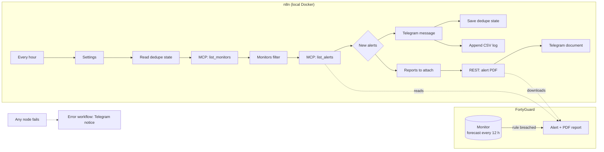
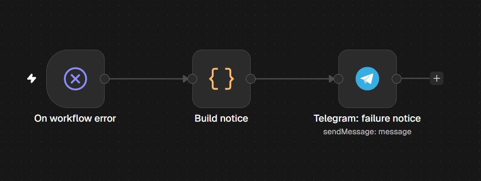

# Architecture

How Site Heat Watch is put together, and why. For setup, see the [README](../README.md).

## Overview



| Component | Where | Role |
|---|---|---|
| FortyGuard monitor | FortyGuard | Watches one heatmap area, checks the forecast every 12 hours, and raises an alert when a rule is breached. Created once per site by an agent or REST. |
| Main workflow | `n8n/workflows/heat-watch.json` | Hourly: finds new alerts, sends them to Telegram, saves state and log, optionally attaches the PDF. |
| Error workflow | `n8n/workflows/heat-watch-errors.json` | Sends a Telegram notice when any main-workflow run fails. |
| Code node source | `n8n/src/` | The JavaScript that runs inside the Code nodes (see [Source layout](#source-layout)). |
| State | `data/` (host) = `/files` (container) | `seen-alerts.json` (dedupe) and `alerts-log.csv` (audit log). Git-ignored. |

## One hourly run

1. **Settings** holds every tunable value. The Code nodes validate them on each run, and an invalid value fails the run with a clear message.
2. **Read seen alerts / Extract seen** load `data/seen-alerts.json`.
3. **MCP: list monitors** calls FortyGuard's `monitoring` tool (`list_monitors`, free). **Monitors** keeps enabled monitors whose name starts with `monitor_name_prefix`. If none match, the run fails on purpose, so the error workflow reports it instead of the chat going quiet.
4. **MCP: list alerts** calls `list_alerts` (free) once per monitor.
5. **New alerts** decides what to send:
   - **First run** (no `initialized` flag in the state file): one "Heat Watch is on" message, and every existing alert is marked as seen. Old alerts are never replayed.
   - **Later runs:** one item per completed alert that hasn't been seen and whose forecast time is still ahead. Alerts already in the past, or without a temperature, are never sent. They're added to the seen list the next time the run sends something, and skipped again until then.
6. **Telegram: alert message** sends each item (HTML parse mode, all dynamic text escaped).
7. **Build state → Save seen alerts** writes the merged, de-duplicated ID list (last 1,000). **Log lines → Append to alert log** writes one CSV row per sent alert.
8. **Reports to attach** picks alerts whose report is ready and that pass `attach_report`, capped at `max_reports_per_run`. **REST: alert report PDF** downloads each one, and **Telegram: report PDF** sends it as a document. The PDF node uses n8n's error output: a failed download sends a short "report unavailable" message and never fails the run.

With n8n's v1 execution order, the message → state → log branch finishes before the PDF branch. If a Telegram send fails, the run stops before state is saved, so the alerts are retried on the next run.

## Data contract

The workflow calls FortyGuard's MCP endpoint (`https://tos-mcp.app.fortyguard.com/mcp`) as a single stateless JSON-RPC `tools/call` POST. The answer is one server-sent event whose `result.content[0].text` holds FortyGuard's `{ok, result: {value}}` envelope. `parseMcpResponse()` in `n8n/src/lib.js` unwraps it and throws on any error shape.

| Operation | Fields used |
|---|---|
| `list_monitors` | `monitor_id`, `name`, `enabled`, `aoi_name`, `timezone`, `rules[]` (`rule_id`, `rule_number`, `temporal_aggregation`, `spatial_aggregation`, `operator`, `threshold`, `unit`) |
| `list_alerts` | `alert_id`, `status`, `predicted_breach_at`, `predicted_breach_temperature` (°C), `predicted_breach_tile_id`, `breached_rules[].rule_id`, `report.ready` |
| REST `GET /v1/monitors/{id}/alerts/{alert_id}/report/download?file_type=pdf` | the PDF bytes |

Alert payloads may number breached rules differently from the monitor, so rules are matched on `rule_id` and described with the monitor's own number.

## State files

`data/seen-alerts.json`:

```json
{ "initialized": true, "seen": ["<alert_id>", "..."], "updated_at": "2026-11-11T11:56:50.919Z" }
```

`data/alerts-log.csv` has the columns `logged_utc, site, alert_id, predicted_breach_utc, timezone, predicted_temp_c, level, rule`. Text fields are quoted, and any that a spreadsheet would read as a formula (starting with `=`, `+`, `-`, `@`) get a leading `'`, following OWASP's CSV-injection guidance.

## Source layout

n8n stores Code-node JavaScript inside the workflow JSON, where it can't be reviewed or tested properly. Here it lives in real files:

```
n8n/src/lib.js            pure functions: parsing, filtering, messages, state, CSV, error notice
n8n/src/nodes/*.js        a few lines of glue per Code node ($('Settings'), $input, ...)
scripts/build_workflows.py  writes lib.js + glue into each Code node
scripts/export_workflows.py n8n editor -> repo, sanitized, then rebuilt and checked
```

`lib.js` has no n8n globals and no dependencies, so the same code runs in n8n and under `node --test`. The tests run both the library and the generated Code nodes, the latter in a small fake n8n context (`n8n/test/workflows.test.js`). CI fails if the workflow files are out of date with the source (`build_workflows.py --check`).

## Design decisions

| Decision | Why |
|---|---|
| Poll hourly | FortyGuard monitors send alerts by email, SMS or WhatsApp. Polling the free `list_alerts` forwards them to a team chat at no cost; an alert can take up to an hour to arrive. |
| MCP over plain HTTP | No custom n8n node or community package to install and trust. An HTTP Request node and a 15-line parser are enough. |
| First-run guard and past-alert skip | Pointing the workflow at an existing account must not flood the chat or spend credits on old reports. |
| PDF only when ready, gated and capped | The PDF download is the only call that may cost credits. |
| Messages never say "no change needed" | The threshold is air temperature; humidity can make a cooler day dangerous. |
| Error workflow | A silent failure would look like "no heat today". |


| Localhost-only, hardened container | See [SECURITY.md](../SECURITY.md). |
